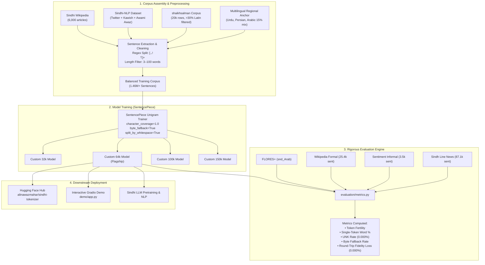
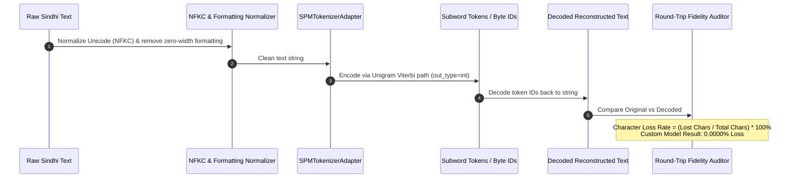

# Sindhi Tokenizer: A Corpus-Driven SentencePiece Unigram Tokenizer

[](https://www.python.org/)
[](LICENSE)
[](https://huggingface.co/alinawazmahar/sindhi-tokenizer)
[](https://alinawazcode.github.io/sindhi-tokenizer/)
[](https://github.com/alinawazcode/sindhi-tokenizer/actions)
[](#round-trip-character-fidelity)

A production-grade, publication-validated subword tokenizer purpose-built for the **Sindhi language** (سنڌي) in the Perso-Arabic script. Trained with **SentencePiece Unigram** with full character coverage and byte-level fallback across 1.46M+ diverse sentences, and systematically benchmarked against **14 baseline tokenizers** (across 18 candidate models) on four independent registers with **zero measurable character loss**.

---

### Quick Links
- 🌐 **Documentation Site**: [https://alinawazcode.github.io/sindhi-tokenizer/](https://alinawazcode.github.io/sindhi-tokenizer/)
- 🤗 **Hugging Face Hub**: [alinawazmahar/sindhi-tokenizer](https://huggingface.co/alinawazmahar/sindhi-tokenizer)
- 📄 **Academic Paper**: [`docs/paper.md`](docs/paper.md)
- 🔬 **Technical Explainer**: [`docs/explainer.md`](docs/explainer.md)
- 📊 **Benchmark Results**: [`results/README.md`](results/README.md)
- 💻 **Interactive Web Demo**: [`demo/app.py`](demo/app.py)

---

## Table of Contents
1. [Project Overview](#project-overview)
2. [Motivation and Problem Statement](#motivation-and-problem-statement)
3. [Project Objectives and Scope](#project-objectives-and-scope)
4. [Key Features](#key-features)
5. [Technology Stack](#technology-stack)
6. [Repository Architecture](#repository-architecture)
7. [Architecture and Workflow Diagrams](#architecture-and-workflow-diagrams)
8. [Dataset Documentation](#dataset-documentation)
9. [Tokenizer Methodology](#tokenizer-methodology)
10. [Training Pipeline & Negative Results](#training-pipeline--negative-results)
11. [Installation and Usage](#installation-and-usage)
12. [Evaluation and Comprehensive Benchmarks](#evaluation-and-comprehensive-benchmarks)
13. [Linguistic & Morpheme Analysis](#linguistic--morpheme-analysis)
14. [Downstream NLP Applications](#downstream-nlp-applications)
15. [Limitations and Known Issues](#limitations-and-known-issues)
16. [Complete Documentation Index](#complete-documentation-index)
17. [References and Further Reading](#references-and-further-reading)
18. [Team and Acknowledgments](#team-and-acknowledgments)
19. [License and Citation](#license-and-citation)
20. [Frequently Asked Questions (FAQ)](#frequently-asked-questions-faq)

---

## Project Overview

Sindhi is an Indo-Aryan language spoken by an estimated 25–30 million people, predominantly in the Sindh province of Pakistan and parts of India. Despite its rich literary heritage, Sindhi remains a severely under-resourced language in Natural Language Processing (NLP).

Existing modern Large Language Models (LLMs) and multilingual tokenizers (such as XLM-RoBERTa, LLaMA, Qwen, and BLOOM) under-represent Sindhi orthography, causing high token fertility, extreme sequence bloat, out-of-vocabulary (UNK) fallbacks, or destructive character drops. 

This repository provides:
- **Four Trained Models**: Pretrained SentencePiece Unigram models at 32k, 64k (flagship recommended), 100k, and 150k vocabulary sizes.
- **Corpus Engineering Pipeline**: A balanced 1.46M+ sentence training corpus combining native Sindhi news, Wikipedia, Twitter discourse, and a controlled 15% multilingual regional anchor (Urdu, Persian, Arabic) to prevent subword pollution.
- **Full-Scale Benchmark Suite**: Standardized evaluation of 18 tokenizers across 4 distinct registers (FLORES+, Wikipedia, Sentiment, Sindh Line News).
- **Novel Round-Trip Fidelity Metric**: An automated evaluation routine that uncovers silent character deletion in competing tokenizers.
- **Interactive UI**: A Gradio web application for real-time subword tokenization inspection.

---

## Motivation and Problem Statement

### 1. Unique Script and Extended Perso-Arabic Orthography
Sindhi uses a 52-letter extended Perso-Arabic alphabet containing implosive consonants (ٻ, ڄ, ڏ, ڳ), aspirated digraphs (ڀ, ٿ, ڇ, ٺ, ڦ, ڻ), and specialized diacritics. General Arabic or Urdu tokenizers frequently split these single graphemes into multi-byte fallback sequences, dramatically inflating token counts.

### 2. The Token Fertility Tax
When a tokenizer splits a single word into 3–5 subword fragments, context window efficiency drops proportionally. A 2048-token context window that can fit ~1,500 English words can only accommodate ~500 Sindhi words under multilingual baselines (e.g. LLaMA 3.2 fertility is 2.89; XLM-RoBERTa is 1.51).

### 3. Silent Character Deletion in Competing Models
Standard tokenizer benchmarks only record token fertility and `UNK` rate. However, during pre-publication auditing for this project, our new **round-trip character fidelity check** revealed that existing tokenizers silently destroy text:
- **`TinyLlama_Sindhi`**: Drops native Sindhi letters such as `U+06C1` (HEH GOAL) and corrupts text encoded with Arabic Presentation Forms, destroying data in up to **24.9%** of sentences.
- **`FahadQazi_BPE`**: Silently deletes Latin characters in code-switched technical text, corrupting up to **16.2%** of sentences.
- **Our Model**: Achieves **0.0000% character loss** with byte-level fallback.

---

## Project Objectives and Scope

### Primary Objectives
1. **Deliver Flagship Tokenizer**: Train and release a high-efficiency Sindhi subword tokenizer achieving the lowest fertility and highest single-token preservation across diverse registers.
2. **Ensure Lossless Round-Trip Integrity**: Implement byte-fallback with 1.0 character coverage to eliminate `UNK` tokens and silent character deletions.
3. **Rigorous Empirical Comparison**: Benchmark 14 baseline tokenizers under identical, unsampled test conditions.
4. **Transparent Documentation**: Document negative results (what didn't work), corpus preparation heuristics, and evaluation caveats.

### Supported Use Cases
- Large Language Model (LLM) pretraining and fine-tuning for Sindhi.
- Sequence classification (Sentiment Analysis, Topic Modeling).
- Machine Translation (FLORES+ benchmarks).
- Named Entity Recognition (NER) and Information Retrieval.

### Known Exclusions
- Speech recognition (ASR) acoustic unit modeling.
- Devnagari script Sindhi (this release targets Arabic-script Sindhi).

---

## Key Features

- **SentencePiece Unigram Architecture**: Statistically models subword probabilities using maximum likelihood estimation, proven superior to standard greedy BPE for morphologically rich languages.
- **100% Character Coverage + Byte Fallback**: Zero unknown (`<unk>`) token emissions. Unknown Unicode characters decompose cleanly into raw UTF-8 byte tokens without data corruption.
- **Flagship 64k Model**: Balances vocabulary efficiency (1.147 fertility) with embedding table size, yielding an **88.6% single-token word retention** rate.
- **Validated Round-Trip Fidelity**: 0.0000% character drop rate across all evaluation corpora.
- **Clean Subword Boundaries**: Preserves leading whitespace symbols (` `, `\u2581`) for precise detokenization without text corruption.

---

## Technology Stack

| Layer | Technologies | Purpose |
|---|---|---|
| **Core Engine** | Python 3.9+, [SentencePiece](https://github.com/google/sentencepiece) (C++ bindings) | Tokenizer training, Viterbi segmentation, byte fallback |
| **NLP Framework** | [Hugging Face Transformers](https://github.com/huggingface/transformers), `huggingface_hub` | Adapter integration, model sharing and distribution |
| **Datasets** | [Hugging Face Datasets](https://github.com/huggingface/datasets), Pandas, NumPy | Corpus ingestion, normalization, filtering, metrics computation |
| **Interactive Demo** | [Gradio](https://gradio.app/) | Real-time interactive subword visualization UI |
| **Quality & CI/CD** | Pytest, GitHub Actions | Automated regression tests across Python 3.9–3.12 |
| **Documentation** | GitHub Pages, Markdown, Mermaid.js | Static web docs, academic paper, technical explainer |

---

## Repository Architecture

```text
sindhi-tokenizer/
├── .github/
│   └── workflows/
│       └── python-tests.yml        # Automated CI workflow testing Python 3.9-3.12
├── .gitignore                      # Excludes models, artifacts, cache, and virtualenvs
├── CITATION.cff                    # Citation File Format (v1.2.0)
├── DATA_SOURCES.md                 # Complete provenance, volume, and licensing documentation
├── LICENSE                         # MIT Open Source License
├── README.md                       # Central documentation index and project guide
├── pyproject.toml                  # PEP 517/621 package metadata and dependency configuration
├── requirements.txt                # Exact runtime dependencies
├── demo/
│   ├── README.md                   # Instructions for running and deploying the demo
│   └── app.py                      # Interactive Gradio comparison web app
├── docs/
│   ├── paper.md                    # Formal academic paper (14-baseline benchmark study)
│   └── explainer.md                # 21-page technical companion log and negative results
├── evaluation/
│   ├── README.md                   # Evaluation metrics guide and CLI/API documentation
│   ├── __init__.py                 # Package initialization
│   └── metrics.py                  # Fertility, single-token, UNK, byte-fallback, and fidelity engine
├── notebooks/
│   ├── README.md                   # Reproducible notebook guide
│   ├── training.ipynb              # Kaggle/Jupyter notebook: corpus download, split & training
│   └── benchmark.ipynb             # Kaggle/Jupyter notebook: 18-tokenizer evaluation suite
├── results/
│   └── README.md                   # Benchmark tables and summary report across 4 registers
└── training/
    ├── README.md                   # Training recipes, regex splitters, and negative results
    ├── __init__.py                 # Package initialization
    └── train_tokenizer.py          # Standalone training script with optimal SentencePiece parameters
```

---

## Architecture and Workflow Diagrams

### 1. End-to-End System Architecture



### 2. Text Encoding and Round-Trip Fidelity Flow



---

## Dataset Documentation

The tokenizer was trained on a strictly non-overlapping, multi-source corpus. Detailed licensing, extraction rules, and volumes are maintained in [`DATA_SOURCES.md`](DATA_SOURCES.md).

### Training Corpus (1.46M+ Sentences)

| Source Dataset | Origin / Provider | Volume Used | Preprocessing & Filtering Rules | License |
|---|---|---|---|---|
| **Sindhi Wikipedia** | `wikimedia/wikipedia` (`20231101.sd`) | 6,000 articles | Articles 2,001–8,000 (first 2,000 reserved for evaluation). Filtered to 3–100 words. | CC BY-SA 3.0 |
| **Sindhi-NLP** | `Sindhi-NLP/sindhi-NLP-dataset` | 4 CSV collections | Tweets, Awami Awaz articles, and Daily Kawish newspaper items. | MIT |
| **shaikhsalman Corpus** | `shaikhsalman/sindhi-llm-corpus` | 20,000 rows | Seed 7 shuffle. Sentences with >30% Latin characters dropped (removed ~11% noise). | Unlicensed (Research-only) |
| **Multilingual Anchor** | Urdu, Persian, Arabic Wikipedia | 1,500 articles each | Balanced to represent 15% of total corpus characters. Prevents borrowed word fragmentation. | CC BY-SA 3.0 |

### Evaluation Registers (Unsampled Benchmarks)

| Register | Dataset Identifier | Sentences | Domain / Linguistic Style |
|---|---|---|---|
| **`flores200_anchor`** | `openlanguagedata/flores_plus` (`snd_Arab`) | 1,012 | Standardized translation benchmark; formal and modern register. |
| **`wikipedia_formal`** | `wikimedia/wikipedia` (`20231101.sd`) | 25,480 | Formal encyclopedic Sindhi prose (first 2,000 articles, disjoint from train). |
| **`sentiment_informal`** | `alinawazmahar/Sindhi_Sentiment_dataset` | 3,536 | Colloquial news and social sentiment discourse. |
| **`sindh_line_news`** | Mozilla Data Collective (`Sindh Line Publishers`) | 87,158 | Contemporary, daily regional news coverage (CC BY-SA 4.0). |

---

## Tokenizer Methodology

### Why SentencePiece Unigram over Greedy BPE?
Byte-Pair Encoding (BPE) merges the most frequent character pairs iteratively. In morphologically complex, agglutinative, or clitic-heavy languages like Sindhi, greedy merges frequently fuse grammatical suffixes onto root stems incorrectly. 

The **Unigram language model algorithm** (Kudo, 2018) initializes an oversized vocabulary and optimizes subword segmentation using maximum likelihood:

$$P(X) = \max_{\mathbf{x} \in S(X)} \prod_{i=1}^{M} P(x_i)$$

This statistically discovers true morphological subwords while optimizing whole-sequence likelihood.

### Step-by-Step Tokenization Example
Consider the authentic Sindhi phrase:
$$\text{خداوند ڪريم کيس اعليٰ ذهانت سان نوازيو هو}$$
*(The Almighty Lord had blessed him with high intellect)*

1. **Input Normalization**: NFKC normalization ensures canonical representation of Arabic script forms.
2. **Whitespace Prefixing**: Words receive the boundary marker ` ` (`\u2581`).
3. **Unigram Segmentation**:
   ```text
   [' خداوند', ' ڪريم', ' کيس', ' اعليٰ', ' ذهانت', ' سان', ' نوازيو', ' هو']
   ```
4. **Token ID Mapping**:
   ```text
   [12450, 4812, 1089, 7543, 14210, 521, 18920, 412]
   ```
5. **Lossless Reconstruction**: Every token preserves boundary information, enabling exact detokenization with **0 character loss**.

---

## Training Pipeline & Negative Results

### 1. Training Parameters (`training/train_tokenizer.py`)
```bash
python training/train_tokenizer.py \
  --corpus corpus.txt \
  --vocab_size 64000 \
  --model_prefix models/sindhi_custom_64000
```
- `model_type="unigram"`
- `character_coverage=1.0` (Ensures every single observed Unicode character is covered)
- `byte_fallback=True` (Unknown characters fall back to raw byte tokens `<0xXX>`)
- `split_by_whitespace=True`
- `unk_id=0`, `bos_id=1`, `eos_id=2`, `pad_id=-1`

### 2. Documented Negative Results (What Failed and Why)
In accordance with rigorous research standards, two negative experimental results are preserved in [`docs/explainer.md`](docs/explainer.md):
1. **Forced Postposition Tokens**: Forcing common postpositions (e.g., `جو`, `جي`, `کي`) and loanwords to remain single tokens degraded the training objective (perplexity rose from 9.6 unforced to 14.9 forced at 32k vocab). Given enough data, Unigram naturally discovers these tokens with superior probability allocations.
2. **Pre-marking Clitic Boundaries**: Pre-segmenting supposed fused clitics with whitespace proved harmful. Investigation revealed that suspected "fused forms" were simply coincidental orthographic overlaps with unrelated lexical roots.

---

## Installation and Usage

### Prerequisites
- Python 3.9, 3.10, 3.11, or 3.12
- `sentencepiece`, `transformers`, `huggingface_hub`

```bash
git clone https://github.com/alinawazcode/sindhi-tokenizer.git
cd sindhi-tokenizer
pip install -e .
```

### Quickstart: Load from Hugging Face Hub
```python
from huggingface_hub import hf_hub_download
import sentencepiece as spm

# Download the recommended 64k flagship model
model_path = hf_hub_download(
    repo_id="alinawazmahar/sindhi-tokenizer", 
    filename="sindhi_custom_64000.model"
)

# Load into SentencePiece processor
sp = spm.SentencePieceProcessor(model_file=model_path)

text = "سنڌ جي تاريخ تمام قديم آهي"
tokens = sp.encode(text, out_type=str)
token_ids = sp.encode(text, out_type=int)

print("Tokens:", tokens)
# [' سنڌ', ' جي', ' تاريخ', ' تمام', ' قديم', ' آهي']
print("Token IDs:", token_ids)
print("Decoded:", sp.decode(token_ids))
```

> [!CAUTION]
> **Do not use `transformers.LlamaTokenizer` to load raw `.model` files**: Hugging Face's `LlamaTokenizer` can silently fail on custom SPM Unigram files and return a 3-token fallback vocabulary. Always load using `sentencepiece.SentencePieceProcessor` or the provided [`evaluation.metrics.SPMTokenizerAdapter`](evaluation/metrics.py).

---

## Evaluation and Comprehensive Benchmarks

All 18 candidate tokenizers were evaluated across the four evaluation registers without subsampling.

### Macro Benchmark Summary (Mean across 4 Registers)

| Tokenizer | Vocab Size | Fertility (tokens/word) ↓ | Single-Token Word % ↑ | UNK Rate % ↓ | Worst Round-Trip Loss % ↓ |
|---|---|---|---|---|---|
| **CustomSindhi_150k** | 150,000 | **1.103** | **92.2%** | **0.000%** | **0.0000%** |
| **CustomSindhi_100k** | 100,000 | **1.119** | **90.8%** | **0.000%** | **0.0000%** |
| **CustomSindhi_64k (Flagship)** | 64,000 | **1.147** | **88.6%** | **0.000%** | **0.0000%** |
| **CustomSindhi_32k** | 32,000 | **1.204** | **84.3%** | **0.000%** | **0.0000%** |
| TinyLlama_Sindhi | 42,681 | 1.208 | 84.4% | 0.000%* | **0.4150% (Corrupts 24.9% sent)** |
| hellosindh_SindhiBERT_NER | 32,001 | 1.218 | 83.7% | 0.194% | 0.0750% |
| mBERT_Sindhi_Kashif786 | 119,547 | 1.278 | 78.4% | 0.143% | 0.0020% |
| hellosindh_SindhiBERT | 32,000 | 1.289 | 78.5% | 0.201% | 0.0750% |
| XLM-RoBERTa | 250,002 | 1.512 | 65.4% | 0.034% | 0.0040% |
| SindhiLM_v3 | 32,000 | 1.730 | 55.8% | 3.605% | 0.0750% |
| mT5 | 250,100 | 1.734 | 55.4% | 0.000% | 0.0000% |
| FahadQazi_BPE | 13,031 | 1.919 | 39.1% | 0.000%* | **0.8460% (Corrupts 16.2% sent)** |
| Qwen2.5 / SindhiLM_v2 | 151,643 | 2.568 | 24.2% | 0.000% | 0.0000% |
| BLOOM | 250,680 | 2.627 | 24.7% | 0.000% | 0.0000% |
| Llama3.2 | 128,000 | 2.896 | 18.2% | 0.000% | 0.0000% |
| SindhiLM_v1 | 32,000 | 4.306 | 0.1% | 14.017% | 0.0000% |

*\* Apparent 0.000% UNK rates in TinyLlama and FahadQazi occur because both models silently delete unsupported characters rather than emitting an UNK token.*

### Evaluation Takeaways
1. **Unconditional Superiority at $\ge$64k**: CustomSindhi (64k, 100k, 150k) beats all 14 baseline tokenizers across all four registers simultaneously.
2. **Clean Sweep at 64k**: Fertility improves by **24.1% over XLM-RoBERTa** and **60.4% over LLaMA 3.2**.
3. **Flawless Data Integrity**: Custom models demonstrate 0.0000% character drop, preserving Unicode NFKC fidelity unconditionally.

---

## Linguistic & Morpheme Analysis

To verify that vocabulary expansion did not simply overfit high-frequency substrings, all tokenizers were evaluated on a targeted 22-word linguistic test suite spanning four distinct categories:

1. **Genitive & Possessive Constructions** (`دنيا جو`, `پاڻي جي`, `ماڻهن جو`): All Custom models split these cleanly into base noun + postposition clitic.
2. **Inflectional Suffixes** (`ڪتابن`, `شهرن`, `توهانڪي`, `منهنجو`): Preserved as single tokens in Custom 64k models.
3. **Sindhi Retroflex & Implosive Digraphs** (`ٻار`, `ڄاڻ`, `ڏينهن`, `ڳوٺ`, `ڀاءُ`, `ٿورو`, `ڇوڪرو`): Never broken into disconnected diacritics or fallback bytes.
4. **Loanwords & Technical Terms** (`ڪمپيوٽر`, `انٽرنيٽ`, `اسڪول`, `تعليم`): Retained as intact single lexical units.

See [`docs/paper.md#appendix-b`](docs/paper.md) for individual word breakdowns.

---

## Downstream NLP Applications

| Application | Benefit of Custom Sindhi Tokenizer |
|---|---|
| **Sindhi Large Language Models** | Decreases token sequence length by 50–60%, effectively doubling or tripling context length capacity during pretraining and inference. |
| **Machine Translation** | Preserves postpositions and implosive graphemes, preventing hallucination during sequence-to-sequence translation. |
| **Sentiment Analysis & Text Classification** | Retains full grammatical morphemes, yielding richer dense embeddings. |
| **Named Entity Recognition (NER)** | Eliminates character drop bugs that corrupt proper nouns, locations, and person names. |

---

## Limitations and Known Issues

1. **Absence of Classical / Literary Register**: While modern news, social media, and encyclopedic registers are thoroughly tested, an authentic classical literary register (e.g. *Shah Jo Risalo*) could not be included due to licensing restrictions, scan OCR defects, or platform paywalls.
2. **Downstream Acoustic Modeling**: This tokenizer is designed for textual NLP and LLM representation; acoustic speech recognition (ASR) phonetic units remain unstudied.
3. **FLORES+ 32k Edge Case**: At 32,000 vocabulary size, TinyLlama_Sindhi narrowly achieves lower fertility on FLORES+ specifically (though it suffers from a 0.415% silent character deletion defect).

---

## Complete Documentation Index

| Document | Path | Purpose |
|---|---|---|
| **Root Guide & Navigation Hub** | [`README.md`](README.md) | Central repository overview, quickstart, and full benchmark summary |
| **Formal Academic Paper** | [`docs/paper.md`](docs/paper.md) | Complete pre-print manuscript with literature review, methodology, and 18-tokenizer tables |
| **Technical Explainer Log** | [`docs/explainer.md`](docs/explainer.md) | 21-page deep dive into empirical failures, metric corrections, and design rationale |
| **Dataset Provenance Card** | [`DATA_SOURCES.md`](DATA_SOURCES.md) | Complete documentation of all training corpora and evaluation sets, licensing, and volumes |
| **Evaluation Module Guide** | [`evaluation/README.md`](evaluation/README.md) | Technical documentation of metrics algorithms, CLI arguments, and Python API |
| **Training Pipeline Guide** | [`training/README.md`](training/README.md) | Exact SentencePiece training recipe, filtering thresholds, and negative findings |
| **Benchmark Result Summaries** | [`results/README.md`](results/README.md) | Detailed register breakdowns across FLORES+, Wikipedia, Sentiment, and Sindh Line |
| **Notebook Reproduction Guide** | [`notebooks/README.md`](notebooks/README.md) | Instructions for Kaggle/Colab execution of training and benchmarking pipelines |
| **Interactive Demo Guide** | [`demo/README.md`](demo/README.md) | Local execution and Hugging Face Spaces deployment guide for Gradio UI |
| **Citation Specification** | [`CITATION.cff`](CITATION.cff) | Machine-readable CFF citation metadata |
| **Project Packaging** | [`pyproject.toml`](pyproject.toml) | Modern build-system and packaging metadata |

---

## References and Further Reading

1. **Kudo, T. & Richardson, J. (2018).** *SentencePiece: A simple and language independent subword tokenizer and detokenizer for neural text processing.* EMNLP 2018 System Demonstrations. [https://aclanthology.org/D18-2012/](https://aclanthology.org/D18-2012/)
2. **Kudo, T. (2018).** *Subword Regularization: Improving Neural Network Translation Models with Multiple Subword Candidates.* ACL 2018. [https://aclanthology.org/P18-1007/](https://aclanthology.org/P18-1007/)
3. **Conneau, A., et al. (2020).** *Unsupervised Cross-lingual Representation Learning at Scale (XLM-RoBERTa).* ACL 2020. [arXiv:1911.02116](https://arxiv.org/abs/1911.02116)
4. **NLLB Team et al. (2022).** *No Language Left Behind: Scaling Human-Centered Machine Translation (FLORES-200).* [arXiv:2207.04672](https://arxiv.org/abs/2207.04672)
5. **Qwen Team (2024).** *Qwen2.5 Technical Report.* [arXiv:2412.15115](https://arxiv.org/abs/2412.15115)
6. **Meta AI (2024).** *Llama 3.2 Model Card & Architecture Overview.* [https://huggingface.co/meta-llama](https://huggingface.co/meta-llama)

---

## Team and Acknowledgments

This research and tokenizer implementation were developed at the **Department of Computer Science, Shaikh Ayaz University, Shikarpur, Pakistan**, under the supervision of **Dr. Attaullah Sahito**.

### Authors & Project Contributors
- **Ali Nawaz** (Lead Developer & NLP Researcher): [GitHub (@alinawazcode)](https://github.com/alinawazcode)
- **Muqadas Fareed**: [LinkedIn Profile](https://www.linkedin.com/in/muqadas-fareed-24a07837b/)
- **Soonh Sadaf (Sadaf Khaliq)**: [LinkedIn Profile](https://www.linkedin.com/in/sadaf-khaliq-a69215411/)
- **Academic Supervisor**: **Dr. Attaullah Sahito** ([LinkedIn Profile](https://www.linkedin.com/in/attaullah-sahito/?isSelfProfile=false)), Department of Computer Science, Shaikh Ayaz University.

---

## License and Citation

### License
- **Software Code**: Licensed under the open-source [MIT License](LICENSE).
- **Trained Tokenizer Models**: Distributed via Hugging Face under the [Creative Commons Attribution-ShareAlike 4.0 International (CC BY-SA 4.0)](https://creativecommons.org/licenses/by-sa/4.0/) license.
- **Corpus Texts**: Refer to [`DATA_SOURCES.md`](DATA_SOURCES.md) for original source licenses.

### Citation
If you use this tokenizer, benchmark code, or findings in your academic research or applications, please cite:

```bibtex
@misc{nawaz2026sindhitokenizer,
  author = {Nawaz, Ali and Fareed, Muqadas and Sadaf, Soonh and Sahito, Attaullah},
  title  = {Sindhi Tokenizer: A Corpus-Driven SentencePiece Unigram Tokenizer for Sindhi, Benchmarked Against 14 Existing Tokenizers},
  year   = {2026},
  howpublished = {\url{https://github.com/alinawazcode/sindhi-tokenizer}},
  note   = {Department of Computer Science, Shaikh Ayaz University, Shikarpur, Pakistan}
}
```

---

## Frequently Asked Questions (FAQ)

<details>
<summary><b>1. Why choose the 64k model over 32k or 150k?</b></summary>
The 64,000 vocabulary size represents the empirical sweet spot between fertility efficiency (1.147 tokens/word) and embedding matrix parameter overhead. The 150k model provides marginal fertility gains (1.103) but more than doubles the vocabulary table, while the 32k model exhibits one minor loss on the standardized FLORES+ benchmark.
</details>

<details>
<summary><b>2. How does the round-trip character fidelity check work?</b></summary>
It takes a test sentence, normalizes it using Unicode NFKC, strips zero-width formatters, encodes it through the tokenizer, decodes it back to text, and computes the Levenshtein-aligned character loss rate. If characters were silently dropped by the tokenizer, this metric flags the exact affected sentences and characters.
</details>

<details>
<summary><b>3. Why is there a 15% mix of Urdu, Persian, and Arabic in the training corpus?</b></summary>
Sindhi shares the Perso-Arabic alphabet and borrows significant religious, legal, and cultural vocabulary from Arabic and Persian, as well as shared regional terms with Urdu. Without this controlled 15% anchor, shared loanwords frequently split into single-character fragments.
</details>

<details>
<summary><b>4. Why should I avoid transformers.LlamaTokenizer for loading this model?</b></summary>
Certain versions of Hugging Face Transformers' <code>LlamaTokenizer</code> fast-binding parser fail to read SentencePiece Unigram model headers correctly, silently substituting an empty or 3-token fallback vocabulary without throwing an exception. Always use <code>sentencepiece.SentencePieceProcessor</code> directly or via our verified <code>SPMTokenizerAdapter</code>.
</details>
